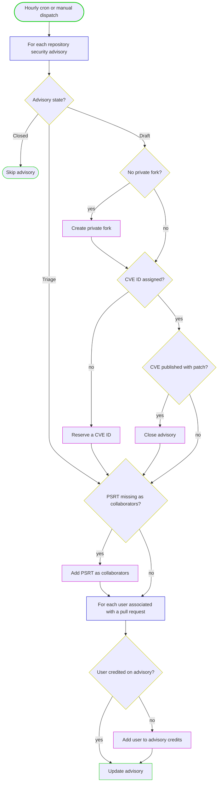

# PSRT GHSA Bot

PSRT GHSA Bot is a GitHub App that automates the [Python Security Response Team
(PSRT)](https://devguide.python.org/security/psrt/)'s
handling of GitHub Security Advisories. It runs hourly (or by manual dispatch)
and does housekeeping on every advisory.

* For newly accepted advisories, it reserves a CVE ID, creates a private
  fork, and adds the PSRT team as collaborators.
* For accepted advisories, if the associated CVE has been published with
  a patch, it closes the advisory.

It only processes installations owned by the account named in the `GH_REQUIRED_ORG`
environment variable; installations under any other user are skipped.
For that account it processes every repository the GitHub App is installed on.
The process is identical across repositories except that CVE IDs are only
reserved for repositories listed in the `CVE_ENABLED_REPOS` environment variable.

